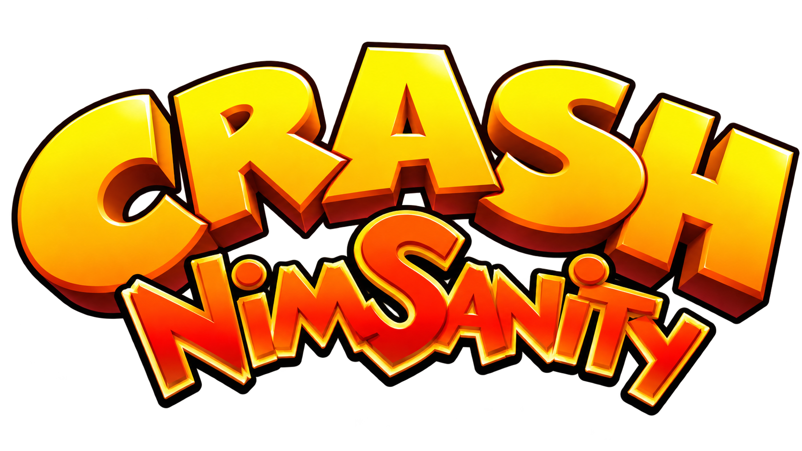

<!-- # ISC License -->
<!-- # -->
<!-- # Copyright (c) 2026 Caleb Blackler -->
<!-- # -->
<!-- # Permission to use, copy, modify, and/or distribute this software for any -->
<!-- # purpose with or without fee is hereby granted, provided that the above -->
<!-- # copyright notice and this permission notice appear in all copies. -->
<!-- # -->
<!-- # THE SOFTWARE IS PROVIDED "AS IS" AND THE AUTHOR DISCLAIMS ALL WARRANTIES WITH -->
<!-- # REGARD TO THIS SOFTWARE INCLUDING ALL IMPLIED WARRANTIES OF MERCHANTABILITY -->
<!-- # AND FITNESS. IN NO EVENT SHALL THE AUTHOR BE LIABLE FOR ANY SPECIAL, DIRECT, -->
<!-- # INDIRECT, OR CONSEQUENTIAL DAMAGES OR ANY DAMAGES WHATSOEVER RESULTING FROM -->
<!-- # LOSS OF USE, DATA OR PROFITS, WHETHER IN AN ACTION OF CONTRACT, NEGLIGENCE OR -->
<!-- # OTHER TORTIOUS ACTION, ARISING OUT OF OR IN CONNECTION WITH THE USE OR -->
<!-- # PERFORMANCE OF THIS SOFTWARE. -->

<p align="center">
  
</p>

# crash-nimsanity

An experimental, cross-platform **native rewrite of Crash Twinsanity (2004)**, written in [Nim](https://nim-lang.org/).

The goal is to reverse engineer the original PlayStation 2 game and recreate its engine and gameplay in readable, idiomatic Nim. This is **not** a byte-matching decompilation or an emulator. Rendering is implemented with OpenGL via [`nimgl`](https://github.com/nimgl/nimgl).

The project reads game resources **directly from a user-supplied NTSC-U/C PS2 ISO** without requiring assets to be unpacked or distributed separately.

## Status

**Early development — not yet a playable game.**

Current work includes:

- Reading the ISO9660 filesystem and the game's `.BH`/`.BD` archives.
- Decoding `.RM2`/`.SM2` geometry, model relationships, textures, materials and mipmaps.
- Rendering original textured models and experimental level scenes in OpenGL, including connected chunks and placed objects.
- Decoding original game music from `.MH`/`.MB` resources, with stereo playback verified for a sampled track.
- Investigating scene transforms, visibility, collision and other systems needed for a faithful native rewrite.

The renderer is currently a **research and preview environment**. Level rendering and culling are incomplete, and game logic has not yet been recreated.

For detailed discoveries and outstanding questions, see [Asset investigation notes](docs/asset-investigation.md).

## Building

Requirements:

- Nim 2.2.0 or newer, including Nimble.
- A GLFW-compatible platform with OpenGL 3.3 support.
- The project's Nim dependencies, including `nimgl` (declared in the Nimble project).

From the repository root:

```sh
nimble build
nimble run
```

To preview a level chunk from your own ISO (Windows example):

```powershell
.\main.exe --chunk ".\gamefiles\Crash Twinsanity (v1.00).iso" "Levels\Earth\Cavern\cavent.sm2"
```

The ISO is **not included**. This command launches an experimental scene preview, not the retail game. Additional inspection modes are available in the source while the project is under development.

## Game data

You must supply your own legally obtained **Crash Twinsanity NTSC-U/C PlayStation 2 disc image**. The repository does not include game images, original executables, music, models, textures or other copyrighted game resources.

Local game files may be placed in `gamefiles/`, which is ignored by Git. All resource decoding is performed at runtime from the supplied ISO.

## Research and credits

The project draws on research from [Twinsanity Editor](https://github.com/Smartkin/twinsanity-editor), [twinsanity-reversed](https://github.com/Smartkin/twinsanity-reversed), [KnuxLib](https://github.com/Knuxfan24/KnuxLib), [vgmstream](https://github.com/vgmstream/vgmstream), FFmpeg and PS2SDK, with independent validation against retail data where documented.

See [Asset investigation notes](docs/asset-investigation.md) for detailed references and [Third-party licenses](docs/THIRD_PARTY_LICENSES.md) for applicable attribution and license notices.

## License

The project's original code is licensed under the [ISC License](LICENSE). Third-party material retains its respective licensing requirements.

*Crash Twinsanity* and associated names, characters and assets belong to their respective rights holders. **crash-nimsanity** is an independent, unofficial fan project and is not affiliated with or endorsed by those rights holders.